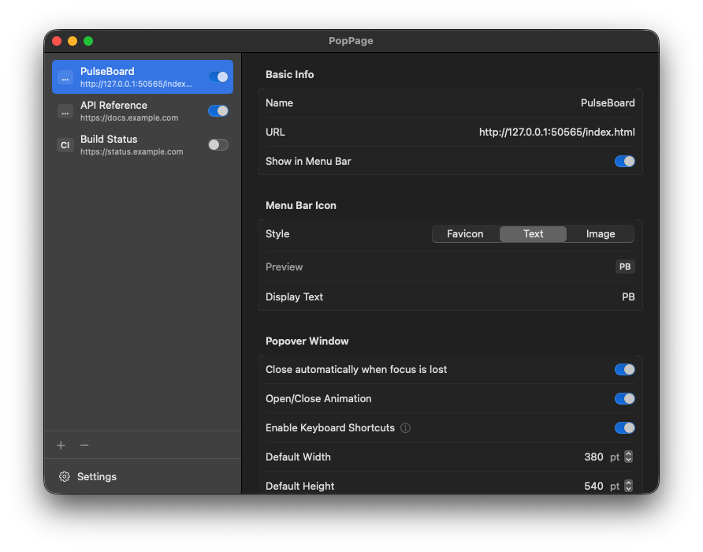

[English](../README.md) | [한국어](README.ko.md) | [简体中文](README.zh-Hans.md) | [日本語](README.ja.md) | [Español](README.es.md) | Deutsch | [Français](README.fr.md) | [tlhIngan Hol](README.tlh.md)

# PopPage

[](#voraussetzungen)
[](#voraussetzungen)
[](https://github.com/badugisoft/poppage/releases/latest)
[](https://badugisoft.github.io/poppage/)

Eine schlanke, Swift-basierte macOS-Menüleisten-App, um Websites anzuheften und schnell in einem Popover zu öffnen.

[Website](https://badugisoft.github.io/poppage/) · [Neueste Version](https://github.com/badugisoft/poppage/releases/latest) · [Screenshots](#screenshots) · [Funktionen](#funktionen) · [Tastaturkurzbefehle](#tastaturkurzbefehle) · [Changelog](../CHANGELOG.md)

## Warum PopPage?

Es gibt bereits viele ähnliche macOS-Menüleisten-Browser — manche mit deutlich größerem Funktionsumfang — wie **MenubarX**, **FloatBrowser** und **MenuBox**. PopPage entstand aus dem Bedarf nach einer **vollständig kostenlosen**, **schlanken** nativen App, die sich auf die wirklich wichtigen Funktionen beschränkt (Symbolanpassung pro Seite, Navigationsrichtlinien, benutzerdefinierte HTTP-Header sowie Export/Import der Einstellungen), ohne unnötigen Ballast.

Diese App wurde **zu 100 % mit Antigravity entwickelt**.

## Screenshots

| Popover-Fenster | Seiteneinstellungen | App-Einstellungen |
| :---: | :---: | :---: |
|  |  |  |

## Download & Installation

1. Lade die neueste signierte und notarisierte `.dmg`- oder `.zip`-Datei (Apple Silicon) von [GitHub Releases](https://github.com/badugisoft/poppage/releases/latest) herunter.
2. Öffne die `.dmg` (oder entpacke die `.zip`) und ziehe **PopPage.app** in `/Applications`.
3. Starte **PopPage** über Programme oder Spotlight.

> Vorgefertigte Builds enthalten kein Intel (`x86_64`); bei Bedarf bitte [aus dem Quellcode bauen](#aus-dem-quellcode-bauen).

## Funktionen

- **Seitenverwaltung**: Websites im Verwaltungsfenster hinzufügen, bearbeiten, löschen, neu anordnen und aktivieren/deaktivieren
- **Anpassung des Menüleisten-Symbols**: Favicons automatisch abrufen, eigenen Text verwenden oder ein benutzerdefiniertes Bild auswählen (inkl. Vorlagenmodus)
- **Popover-Umschaltung & Fokusverhalten**: Per Klick auf das Menüleisten-Symbol ein-/ausblenden und optional automatisch bei Fokusverlust schließen
- **Öffnen-/Schließen-Animation**: Animation pro Seite ein- oder ausschaltbar
- **Richtlinien für neue Fenster & Navigation**:
  - Links für neue Fenster (`target="_blank"` usw.) im Standardbrowser öffnen
  - Seitennavigation konfigurieren (`Nicht navigieren` / `Im externen Browser öffnen` / `Im Popover navigieren`)
- **Benutzerdefinierte HTTP-Header**: HTTP/HTTPS-Anfrage-Header pro Seite (einschließlich `User-Agent`) hinzufügen, umschalten und entfernen
- **Popover-Größe & Größenänderung**: Standardbreite/-höhe festlegen, unten rechts per Griff anpassen und geänderte Größen optional merken
- **Zoom-Steuerung**: Standardzoom pro Seite festlegen und geänderten Zoom optional merken
- **Tastaturkurzbefehle**: Pro Seite umschaltbare Popover-Kurzbefehle mit kompakter Kurzbefehl-Übersicht neben dem Schalter
- **Untere Symbolleiste & Overlay**: Sichtbarkeit von Zurück/Vorwärts-, Neu-laden- und Zoom-Tasten steuern oder die Symbolleiste mit einstellbarer Deckkraft über der Webseite einblenden
- **Adaptiver Symbolleisten-Hintergrund**: Passt die Farbe der unteren Symbolleiste automatisch an den Hintergrund der Webseite an
- **App-Einstellungen**: Automatischen Start bei Anmeldung, App-Sprache (`Systemstandard` / `English` / `한국어` / `简体中文` / `日本語` / `Español` / `Deutsch` / `Français` / `tlhIngan Hol`) sowie Export/Import von Einstellungen (Seiten, eigene Symbole und Sprache) als JSON im Tab „Einstellungen“ konfigurieren
- **Lokalisierung**: Unterstützt Englisch (Standard), Koreanisch, Vereinfachtes Chinesisch, Japanisch, Spanisch, Deutsch, Französisch und Klingonisch

## Tastaturkurzbefehle

Verfügbar im Popover, wenn **Tastaturkurzbefehle aktivieren** für die Seite eingeschaltet ist:

| Kurzbefehl | Aktion |
| :---: | :--- |
| `⌘ +` | Vergrößern |
| `⌘ -` | Verkleinern |
| `⌘ 0` | Zoom zurücksetzen |
| `⌘ [` | Zurück |
| `⌘ ]` | Vorwärts |
| `⌘ R` | Neu laden |

## Voraussetzungen

- macOS 14.0 oder neuer
- Xcode / Swift 6 Toolchain (zum Bauen aus dem Quellcode)

## Aus dem Quellcode bauen

```bash
# Alle verfügbaren Targets anzeigen
make help

# Debug- / Release-Build
make build
make release

# .app-Bundle erstellen (build/PopPage.app)
make app

# Bauen und starten
make run

# Nach /Applications installieren (oder INSTALL_DIR=/pfad make install)
make install
make uninstall

# AppIcon.icns neu generieren oder plist/strings prüfen
make icon
make lint

# Build-Artefakte entfernen
make clean
```

## Datenspeicherung

- Seitenkonfiguration: `~/Library/Application Support/PopPage/pages.json`
- Zwischengespeicherte Favicons & eigene Bilder: `~/Library/Application Support/PopPage/icons/`
- Spracheinstellung der App: `~/Library/Preferences/com.badugisoft.poppage.plist`
