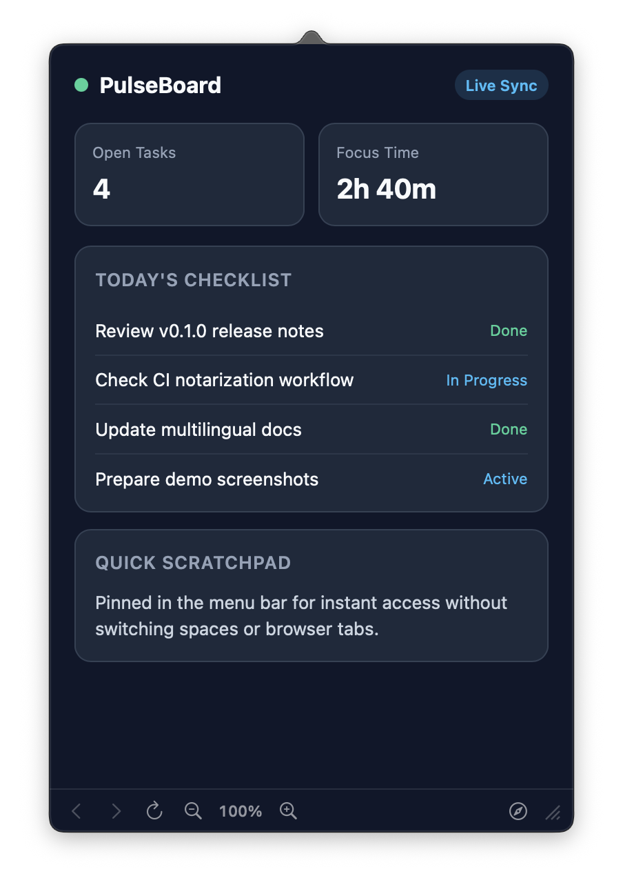
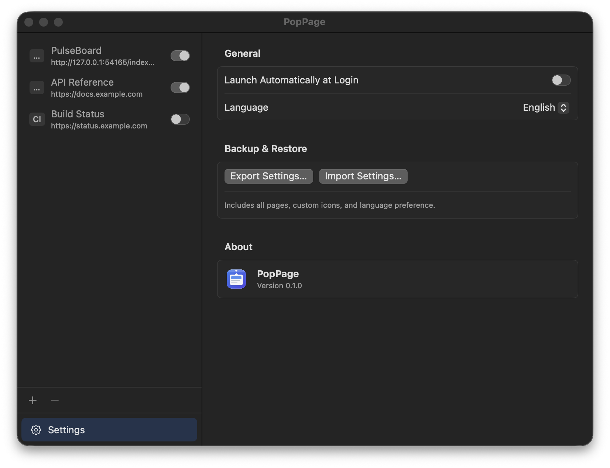

[English](../README.md) | 한국어 | [简体中文](README.zh-Hans.md) | [日本語](README.ja.md) | [Español](README.es.md) | [Deutsch](README.de.md) | [Français](README.fr.md) | [tlhIngan Hol](README.tlh.md)

# PopPage

[](#요구-사항)
[](#요구-사항)
[](https://github.com/badugisoft/poppage/releases/latest)
[](https://badugisoft.github.io/poppage/)

자주 방문하는 웹사이트를 macOS 메뉴바에 등록해 팝오버로 빠르게 열고 닫을 수 있는 Swift 기반 메뉴바 앱입니다.

[웹사이트](https://badugisoft.github.io/poppage/) · [최신 다운로드](https://github.com/badugisoft/poppage/releases/latest) · [스크린샷](#스크린샷) · [주요 기능](#주요-기능) · [단축키](#키보드-단축키) · [변경 이력](../CHANGELOG.md)

## 만든 이유

**MenubarX**, **FloatBrowser**, **MenuBox**처럼 이미 비슷한 macOS 메뉴바 웹 브라우저 앱이 많이 있고, 훨씬 더 많은 기능을 제공하는 앱들도 있습니다. 그럼에도 불필요한 기능 없이 꼭 필요한 기능(페이지별 아이콘 커스터마이징, 이동 정책, 커스텀 HTTP 헤더, 설정 내보내기/가져오기 등)만 담은 **완전히 무료이고 가벼운** 네이티브 앱이 필요해서 만들었습니다.

이 앱은 **100% Antigravity로 제작**되었습니다.

## 스크린샷

| 팝오버 창 | 페이지 설정 | 앱 설정 |
| :---: | :---: | :---: |
|  |  |  |

## 다운로드 및 설치

1. [GitHub Releases](https://github.com/badugisoft/poppage/releases/latest)에서 서명 및 공증이 완료된 최신 `.dmg` 또는 `.zip` 파일을 다운로드합니다.
2. `.dmg`를 열거나 `.zip` 압축을 푼 뒤 **PopPage.app**을 `/Applications` 폴더로 드래그합니다.
3. Applications 또는 Spotlight에서 **PopPage**를 실행합니다.

## 주요 기능

- **페이지 목록 관리**: 앱 실행 시 관리 창에서 웹사이트를 추가, 수정, 삭제, 순서 변경 및 활성/비활성 전환
- **메뉴바 아이콘 커스터마이징**: 웹사이트 파비콘 자동 수집, 사용자 지정 텍스트, 또는 사용자 이미지(템플릿 모드 지원) 선택 가능
- **팝오버 토글 및 포커스 닫힘**: 메뉴바 아이콘 클릭 시 열기/닫기, 팝오버 외부 포커스 이동 시 자동 닫힘 여부 설정
- **열기/닫기 애니메이션**: 페이지별 팝오버 애니메이션 활성화/비활성화
- **새 창 및 페이지 이동 정책**:
  - 새 창 링크(`target="_blank"` 등) 허용 시 외부 기본 브라우저로 열기
  - 현재 페이지 이동 정책 선택 (`이동 안 함` / `외부 브라우저로 열기` / `현재 팝오버에서 이동`)
- **사용자 지정 HTTP 헤더**: 페이지별로 HTTP/HTTPS 요청에 포함할 커스텀 헤더(`User-Agent` 포함) 추가, 활성/비활성, 삭제
- **팝오버 크기 및 리사이즈**: 기본 너비/높이 지정, 우하단 그립을 통한 드래그 크기 조절 및 변경한 크기 유지 여부 설정
- **확대/축소 비율**: 페이지별 기본 확대/축소 비율 지정 및 변경 비율 유지 여부 설정
- **키보드 단축키**: 페이지별로 사용 여부를 설정할 수 있는 팝오버 단축키 및 토글 옆 정보 버튼을 통한 단축키 안내 팝오버 제공
- **툴바 버튼 노출 및 오버레이**: 뒤로/앞으로, 새로고침, 확대/축소 버튼 표시 여부 및 툴바를 웹페이지 위에 오버레이할지 설정 (오버레이 시 배경 불투명도 조절 가능)
- **하단 툴바 배경색 동기화**: 하단 툴바가 웹페이지 배경색에 맞춰 자동으로 색상을 변경
- **앱 설정**: 관리 창 좌측 하단 설정 탭에서 로그인 시 자동 시작, 앱 내 언어(`시스템 기본` / `English` / `한국어` / `简体中文` / `日本語` / `Español` / `Deutsch` / `Français` / `tlhIngan Hol`), 설정 내보내기/가져오기(페이지, 커스텀 아이콘, 언어 포함 JSON) 지원
- **다국어 지원**: 영어(기본), 한국어, 중국어(간체), 일본어, 스페인어, 독일어, 프랑스어, 클링온어 지원

## 키보드 단축키

페이지 설정에서 **키보드 단축키 사용**이 켜져 있을 때 팝오버 내에서 사용할 수 있습니다:

| 단축키 | 동작 |
| :---: | :--- |
| `⌘ +` | 확대 |
| `⌘ -` | 축소 |
| `⌘ 0` | 기본 비율 |
| `⌘ [` | 뒤로 |
| `⌘ ]` | 앞으로 |
| `⌘ R` | 새로고침 |

## 요구 사항

- macOS 14.0 이상
- Xcode / Swift 6 툴체인 (소스에서 직접 빌드하는 경우)

## 소스에서 빌드

```bash
# 사용 가능한 타겟 보기
make help

# 디버그 / 릴리즈 빌드
make build
make release

# .app 번들 생성 (build/PopPage.app)
make app

# 빌드 후 실행
make run

# /Applications에 설치 (또는 INSTALL_DIR=/경로 make install)
make install
make uninstall

# AppIcon.icns 재생성 및 plist/strings 문법 검사
make icon
make lint

# 빌드 산출물 정리
make clean
```

## 데이터 저장 위치

- 페이지 설정: `~/Library/Application Support/PopPage/pages.json`
- 캐시된 파비콘 및 사용자 이미지: `~/Library/Application Support/PopPage/icons/`
- 앱 언어 설정: `~/Library/Preferences/com.badugisoft.poppage.plist`
